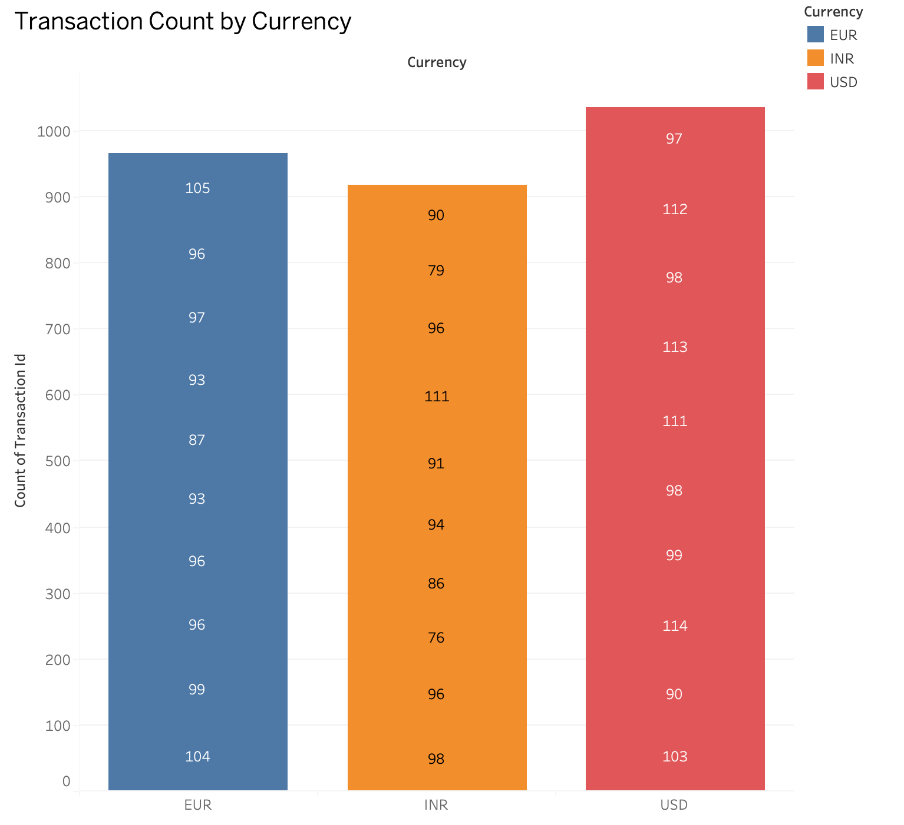
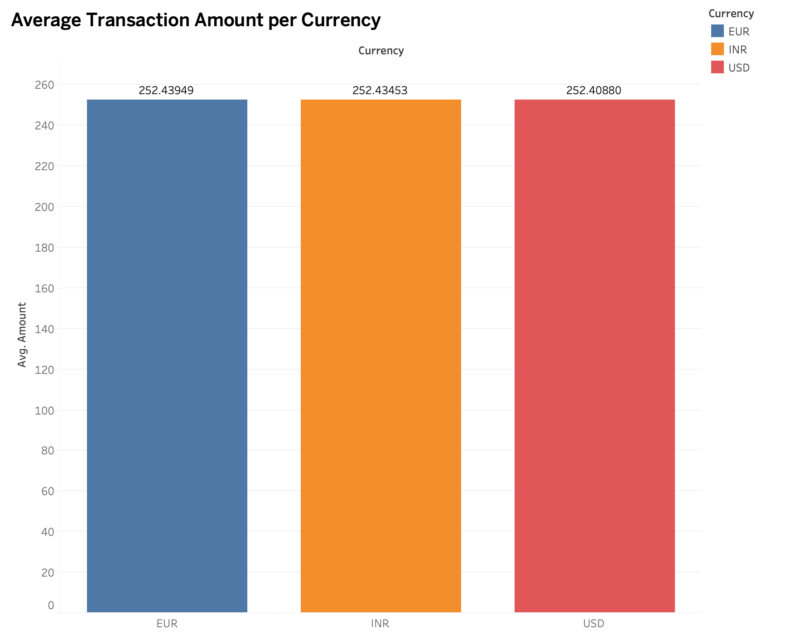
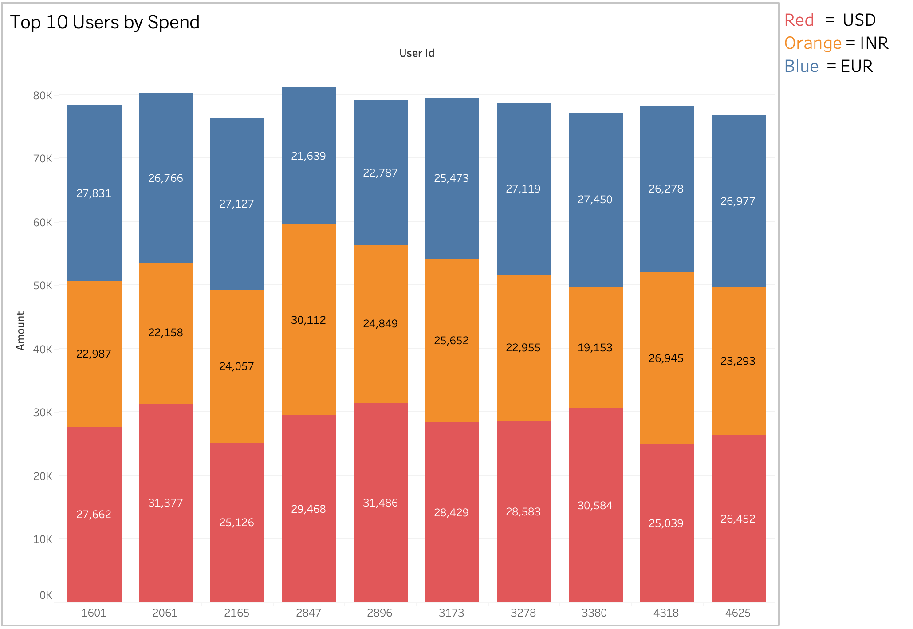
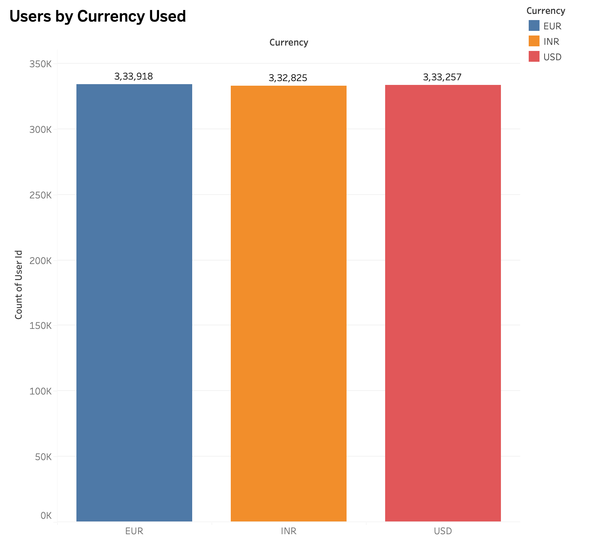

# ETL AWS E-commerce Payments Pipeline

**End-to-end batch analytics stack: raw synthetic payment events → S3 → PySpark Glue ETL → Redshift Serverless → Tableau dashboards.**

---

## The Problem

E-commerce payment data arrives as raw transaction events — unstructured, in mixed currencies, with no aggregations or anomaly signals. Turning that into monthly revenue KPIs, currency breakdowns, and top-spender reports requires a reliable, reproducible batch pipeline. This project implements that pattern end-to-end on AWS, from data generation through SQL-ready serving and BI visualization.

---

## Pipeline — 5 Stages

| Stage | Tool | What happens |
|-------|------|--------------|
| 1. Generate | Python + Faker | 1M+ synthetic payment rows: `transaction_id · user_id · amount · currency · timestamp` |
| 2. Ingest | AWS S3 | Raw CSV uploaded to S3 input prefix |
| 3. Transform | AWS Glue (PySpark) | Cleans data · converts to Parquet · adds `amount_usd` (currency conversion) · adds `month` · flags `is_anomaly` |
| 4. Load | Redshift Serverless | `COPY FROM PARQUET` ingests the transformed S3 prefix into Redshift |
| 5. Model + Visualize | SQL + Tableau | 3 analytical views built in Redshift; Tableau connects for dashboards |

---

## Enriched Schema (8 columns after Glue ETL)

| Column | Type | Added by |
|--------|------|----------|
| `transaction_id` | string | Source |
| `user_id` | string | Source |
| `amount` | numeric | Source |
| `currency` | string | Source |
| `timestamp` | timestamp | Source |
| `amount_usd` | numeric | Glue ETL — currency conversion |
| `month` | string | Glue ETL — derived from timestamp |
| `is_anomaly` | boolean | Glue ETL — threshold-based flag |

---

## Redshift Analytical Models

| View / Table | Purpose |
|-------------|---------|
| `transactions_summary` | Monthly KPIs — total revenue, transaction count, avg transaction value |
| `currency_revenue` | Revenue and volume broken down by currency × month |
| `anomalies` | All records where `is_anomaly = TRUE` for investigation |

---

## Results

| Metric | Value |
|--------|-------|
| Payment records processed | **1,000,000+** |
| Manual reporting time reduction | **60%** |
| Enriched schema columns | **8** (including USD conversion + anomaly flag) |
| Analytical models | **3** (summary · currency · anomalies) |
| Query engine | **Redshift Serverless** (pay-per-query, no cluster management) |
| Output format | **Parquet** (columnar, compressed) |

---

## Tableau Dashboards

| Dashboard | Insight |
|-----------|---------|
| Revenue Over Time | Monthly revenue trend across all currencies |
| Transaction Count by Currency | Volume distribution per currency |
| Avg Transaction Amount per Currency | Which currencies drive high-value orders |
| Top 10 Users by Spend | Highest-spending user accounts |

### Dashboard Screenshots

---

## Demo

### Video Walkthrough
> *2-minute walkthrough: data generation → Glue ETL run → Redshift query → Tableau dashboard.*

---

## Tech Stack

| Layer | Tool |
|-------|------|
| Data generation | Python · Faker |
| Storage | AWS S3 |
| ETL | AWS Glue (PySpark) |
| Data warehouse | Amazon Redshift Serverless |
| Monitoring | AWS CloudWatch |
| Visualization | Tableau |
| Language | Python · SQL |

---

## How to Run

**Prerequisites:** AWS account (S3, Glue, Redshift Serverless) · Tableau Desktop

| Step | Command / Action |
|------|-----------------|
| 1 | Run the Python script to generate `transactions_raw.csv` |
| 2 | Upload `transactions_raw.csv` to your S3 input prefix |
| 3 | Run the Glue PySpark job — output Parquet writes to `s3://your-bucket/transformed/` |
| 4 | In Redshift, run the provided SQL to `COPY FROM PARQUET` and create the three views |
| 5 | Connect Tableau to Redshift and open/refresh the dashboards |

> Data is synthetic and for demonstration only
